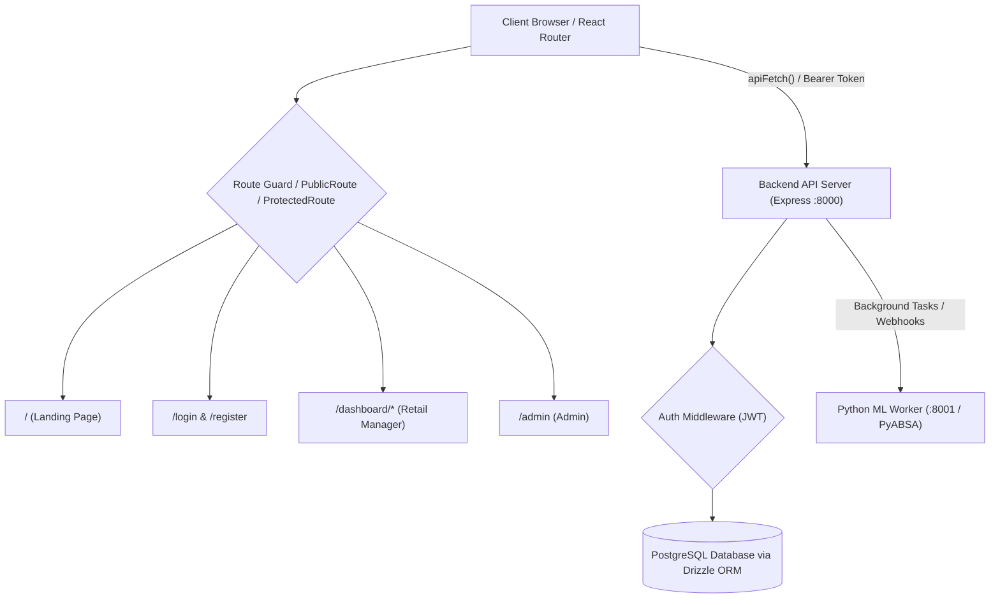

# Feedback Analysis System – Frontend & Backend Routing Architecture

This document provides a comprehensive technical reference for the routing architecture, access control guards, layouts, API endpoints, and end-to-end data flows across both the **Frontend (React Router v8)** and **Backend (Express.js)**.

---

## 1. System Communication Overview

### Communication Principles
1. **Client API Client (`client/src/services/api.ts`)**:
   - All backend requests pass through the centralized `apiFetch` helper.
   - Reads `token` from `localStorage`. If present, automatically injects `Authorization: Bearer <token>`.
   - Automatically handles `401 Unauthorized` and `403 ACCOUNT_SUSPENDED` / `ACCOUNT_DELETED` by clearing credentials and dispatching an auth reset event.
2. **Environment URL Mapping**:
   - Client dev server: `http://localhost:5173`
   - Express API server: `http://localhost:8000/api`
   - Python PyABSA Worker: `http://localhost:8001`

---

## 2. Frontend Routing Architecture (`client/src/App.tsx`)

The frontend is implemented with **React Router v8** inside a single-page architecture with global providers:
- **`QueryClientProvider`** (TanStack React Query for data caching & synchronization)
- **`AuthProvider`** (Session context, user profile, tokens, login/logout methods)
- **`ThemeProvider`** (Light/Dark mode)

### 2.1 Route Guards & Access Control

| Guard Component | Source File | Behavior |
| :--- | :--- | :--- |
| **Public Access** | Direct Route | Always accessible to both public visitors and authenticated users (e.g. `/`). |
| **`PublicRoute`** (AuthRedirect Guard) | `client/src/components/PublicRoute.tsx` | Restricted to anonymous visitors. If an authenticated user attempts to visit `/login`, `/admin/login`, or `/register`, they are immediately redirected to `/dashboard` (for Retail Managers) or `/admin` (for Admins). |
| **`ProtectedRoute`** | `client/src/components/ProtectedRoute.tsx` | Enforces authentication and role boundary. If unauthenticated on an Admin route (`allowedRoles: ['ADMIN']`), redirects to `/admin/login`. If unauthenticated on user routes, redirects to `/login`. If authenticated user tries to access `/admin`, redirects to `/dashboard`. If admin visits user routes, redirects to `/admin`. |

---

### 2.2 Complete Frontend Route Map

| URL Path | Guard | Layout | Target Component | Description |
| :--- | :--- | :--- | :--- | :--- |
| **`/`** | Public (None) | Public Layout | `client/src/pages/LandingPage.tsx` | Public Landing Page: Hero with interactive PyABSA live demo, How It Works, Features, Target Audience, Dynamic Pricing Cards, Public FAQs, and Footer. |
| **`/login`** | `PublicRoute` | Minimal Card | `client/src/pages/Login.tsx` | Retail Manager Sign In only. Authenticates via `/api/auth/login`. Rejects admin accounts. Redirects to `/dashboard`. Contains link to `/admin/login`. |
| **`/admin/login`** | `PublicRoute` | Dark Executive Card | `client/src/pages/AdminLoginPage.tsx` | System Administrator Sign In. Authenticates via `/api/admin/auth/login`. Enforces 5-attempt rate-limiting and lockout. Redirects to `/admin`. Contains link to `/login`. |
| **`/register`** | `PublicRoute` | Minimal Card | `client/src/pages/Register.tsx` | Retail Manager registration only. Admins cannot self-register. Redirects to dashboard if already logged in. |
| **`/dashboard`** | `ProtectedRoute(['RETAIL_MANAGER'])` | `UserDashboardLayout.tsx` | `client/src/pages/user/Overview.tsx` | Retailer Overview: Profile card, storage quota progress bar, quick stats, active subscription status. |
| **`/dashboard/datasets`** | `ProtectedRoute(['RETAIL_MANAGER'])` | `UserDashboardLayout.tsx` | `client/src/pages/user/Datasets.tsx` | CSV review dataset upload, schema validation, dataset deletion, and ML worker status tracker. |
| **`/dashboard/reports`** | `ProtectedRoute(['RETAIL_MANAGER'])` | `UserDashboardLayout.tsx` | `client/src/pages/user/Reports.tsx` | PyABSA Aspect-Sentiment reports: Executive scorecards, sentiment breakdown, stacked aspect bars, product action matrix, word cloud, triplet table, and PDF export. |
| **`/dashboard/subscriptions`** | `ProtectedRoute(['RETAIL_MANAGER'])` | `UserDashboardLayout.tsx` | `client/src/pages/user/Subscriptions.tsx` | Active plan status, free trial activation, Stripe checkout modal, invoices, and tier upgrades. |
| **`/dashboard/settings`** | `ProtectedRoute(['RETAIL_MANAGER'])` | `UserDashboardLayout.tsx` | `client/src/pages/user/Settings.tsx` | Profile details, company metadata, 6-digit email password reset verification, and account deletion. |
| **`/dashboard/help`** | `ProtectedRoute(['RETAIL_MANAGER'])` | `UserDashboardLayout.tsx` | `client/src/pages/user/HelpSupport.tsx` | Dataset formatting guidelines, CSV template download, searchable public FAQs, and feedback submission form. |
| **`/admin`** | `ProtectedRoute(['ADMIN'])` | `DashboardLayout.tsx` | `client/src/pages/AdminDashboard.tsx` | Unified Admin dashboard with tabs: Plan Management, Feedback Inquiries, User Management, and FAQ Management. Logout redirects to `/admin/login`. |
| **`*` (Catch-all)** | None | None | `<Navigate to="/" replace />` | Unknown routes redirect to the landing page `/`. |

---

## 3. Backend Routing Architecture (`server/src/index.ts`)

The backend is built with **Express.js** running on Node.js/TypeScript. All service routes are mounted under the `/api` prefix.

### 3.1 Middleware Pipeline
1. **`cors()`**: Configured with credentials support for `http://localhost:5173`.
2. **`webhooksRoutes`**: Mounted at `/api/webhooks` **before** `express.json()` to preserve the raw binary request stream required for Stripe webhook signature verification.
3. **`express.json()`**: Body parser for application/json payloads.
4. **Request Logger**: Logs incoming HTTP method and request URL.
5. **Auth Middlewares (`server/src/middlewares/authMiddleware.ts`)**:
   - `authenticate`: Validates JWT token in `Authorization: Bearer <token>`. Checks Postgres to ensure user exists and is not `suspended` or `deleted`.
   - `optionalAuthenticate`: Decodes JWT token if present without rejecting unauthenticated requests.
   - `requireAdmin`: Rejects request with `403 Forbidden` if `req.user.role !== 'ADMIN'`.

---

### 3.2 Complete Backend API Route Reference

#### 1. Authentication & Security
*User Auth file: `server/src/routes/auth.ts`*
*Admin Auth file: `server/src/routes/adminAuth.ts`*

| Method | Endpoint | Allowed Role | Security Controls | Description |
| :--- | :--- | :--- | :--- | :--- |
| `POST` | `/api/auth/register` | Public | Role forced to `RETAIL_MANAGER` | Registers a new Retail Manager; Admins cannot self-register. |
| `POST` | `/api/auth/login` | `RETAIL_MANAGER` | Role check (Rejects Admins with 403) | Retail Manager authentication. If an admin attempts login, returns 403 `ADMIN_LOGIN_REQUIRED`. Signs 7-day JWT. |
| `POST` | `/api/admin/auth/login` | `ADMIN` | Stricter lockout (5 attempts -> 15 min lockout), role check, 12h JWT lifetime | Dedicated System Administrator login. Rejects non-admins with 403 `FORBIDDEN_PORTAL`. Shorter 12-hour session lifetime. |

---

#### 2. Subscription Plans (`/api/plans` & `/api/admin/plans`)
*Source file: `server/src/routes/plans.ts`*

| Method | Endpoint | Auth Level | Description |
| :--- | :--- | :--- | :--- |
| `GET` | `/api/plans` | `optionalAuthenticate` | Public/Retailers see active plans. Admins see all plans with subscriber counts. |
| `POST` | `/api/plans` | `authenticate + requireAdmin` | Creates a plan, generates Stripe product & price, and creates a `created` announcement for all users. |
| `PATCH` | `/api/admin/plans/:id` | `authenticate + requireAdmin` | Updates plan details (name, price, quota, duration), updates Stripe price if needed, and dispatches `edited` announcements to active subscribers. |
| `PATCH` | `/api/plans/:id/deactivate` | `authenticate + requireAdmin` | Soft-deactivates plan; calculates personalized subscriber access end dates and creates `deactivated` announcements. |
| `PATCH` | `/api/plans/:id/activate` | `authenticate + requireAdmin` | Reactivates an inactive plan and notifies subscribers. |
| `DELETE`| `/api/plans/:id` | `authenticate + requireAdmin` | Blocks deletion if subscribers > 0. If 0 subscribers, deletes plan and creates `deleted` announcement for all users. |

---

#### 3. In-App Announcements (`/api/announcements`)
*Source file: `server/src/routes/announcements.ts`*

| Method | Endpoint | Auth Level | Description |
| :--- | :--- | :--- | :--- |
| `GET` | `/api/announcements/unseen` | `authenticate` | Fetches the oldest unseen announcement for the logged-in user. Automatically injects personalized deactivation end dates and storage over-limit warnings. |
| `POST` | `/api/announcements/:id/seen` | `authenticate` | Inserts `(user_id, announcement_id)` into `user_announcement_views` so the modal never appears again for this user. |

---

#### 4. Subscriptions & Stripe Billing (`/api/subscriptions`)
*Source file: `server/src/routes/subscriptions.ts`*

| Method | Endpoint | Auth Level | Description |
| :--- | :--- | :--- | :--- |
| `GET` | `/api/subscriptions/me` | `authenticate` | Returns user's active subscription, storage consumption, plan quotas, and trial eligibility. Automatically expires past-due inactive subscriptions. |
| `POST` | `/api/subscriptions/create` | `authenticate` | Activates Free Trial plan (14 days, 75MB storage). |
| `POST` | `/api/subscriptions/purchase`| `authenticate` | Creates a Stripe Checkout session for a selected subscription plan. |
| `POST` | `/api/subscriptions/cancel` | `authenticate` | Cancels auto-renewal on an active Stripe subscription. |
| `GET` | `/api/subscriptions/invoices` | `authenticate` | Retrieves customer payment invoices and receipts from Stripe. |
| `POST` | `/api/subscriptions/sync` | `authenticate` | Synchronizes local subscription state with Stripe customer subscriptions. |

---

#### 5. Dataset Management (`/api/datasets`)
*Source file: `server/src/routes/datasets.ts`*

| Method | Endpoint | Auth Level | Description |
| :--- | :--- | :--- | :--- |
| `GET` | `/api/datasets` | `authenticate` | Lists all datasets uploaded by the current user with ML processing statuses (`PENDING`, `ANALYSIS_IN_PROGRESS`, `COMPLETED`, `FAILED`). |
| `POST` | `/api/datasets/upload` | `authenticate` | Multer multipart upload. Validates CSV headers (`Product_Name`, `Review_Text`), enforces storage quotas, inserts review records, and triggers worker task. |
| `DELETE`| `/api/datasets/:id` | `authenticate` | Deletes dataset and cascaded review triplets, freeing up user storage quota. |

---

#### 6. Reports & PyABSA Analytics (`/api/reports`)
*Source file: `server/src/routes/reports.ts`*

| Method | Endpoint | Auth Level | Description |
| :--- | :--- | :--- | :--- |
| `GET` | `/api/reports/:datasetId/overview` | `authenticate` | Executive analytics: Total review count, aspect sentiment index, positive/neutral/negative distribution, top praised/complained aspects, and action matrix. |
| `GET` | `/api/reports/:datasetId/drilldown`| `authenticate` | Granular triplet search: Filter by polarity, star rating, aspect keyword, and pagination. |

---

#### 7. Profile & Security (`/api/profile`)
*Source file: `server/src/routes/profile.ts`*

| Method | Endpoint | Auth Level | Description |
| :--- | :--- | :--- | :--- |
| `GET` | `/api/profile` | `authenticate` | Returns authenticated user profile, email, and company details. |
| `PUT` | `/api/profile` | `authenticate` | Updates username, company name, and company email. |
| `POST` | `/api/profile/password/request-code` | `authenticate` | Generates a 6-digit code and emails it via Nodemailer (15-min expiration). |
| `POST` | `/api/profile/password/verify-code` | `authenticate` | Verifies code and returns a single-use reset token hash. |
| `POST` | `/api/profile/password/reset` | `authenticate` | Verifies reset token and updates user password. |
| `DELETE`| `/api/profile` | `authenticate` | Soft-deletes user account (`status = 'deleted'`) and invalidates active session. |

---

#### 8. Feedback Inquiries (`/api/feedbacks`)
*Source file: `server/src/routes/feedbacks.ts`*

| Method | Endpoint | Auth Level | Description |
| :--- | :--- | :--- | :--- |
| `POST` | `/api/feedbacks` | `authenticate` | Retailer submits support inquiry or issue report. |
| `GET` | `/api/feedbacks/my` | `authenticate` | Retailer retrieves their submitted feedback tickets and admin replies. |
| `GET` | `/api/feedbacks` | `authenticate + requireAdmin` | Admin lists all inquiries with search and status filtering. |
| `PATCH` | `/api/feedbacks/:id/status`| `authenticate + requireAdmin` | Updates inquiry status (`pending`, `sent`, `replied`). |
| `POST` | `/api/feedbacks/:id/reply` | `authenticate + requireAdmin` | Admin replies to feedback; emails reply to user via Nodemailer. |
| `DELETE`| `/api/feedbacks/:id` | `authenticate + requireAdmin` | Soft-deletes feedback ticket. |

---

#### 9. Admin User Controls (`/api/admin/users`)
*Source file: `server/src/routes/adminUsers.ts`*

| Method | Endpoint | Auth Level | Description |
| :--- | :--- | :--- | :--- |
| `GET` | `/api/admin/users` | `authenticate + requireAdmin` | Paginated listing of all users with search, role, and status filters. |
| `GET` | `/api/admin/users/:id` | `authenticate + requireAdmin` | Retrieves user profile and subscription details. |
| `PATCH` | `/api/admin/users/:id` | `authenticate + requireAdmin` | Updates user details. |
| `PATCH` | `/api/admin/users/:id/status`| `authenticate + requireAdmin` | Suspends or reactivates account; triggers transactional email notification. |
| `GET` | `/api/admin/users/:id/feedbacks` | `authenticate + requireAdmin` | Retrieves all feedback submitted by this specific user. |

---

#### 10. FAQ Management (`/api/faqs` & `/api/admin/faqs`)
*Source files: `server/src/routes/faqs.ts`, `server/src/routes/adminFaqs.ts`*

| Method | Endpoint | Auth Level | Description |
| :--- | :--- | :--- | :--- |
| `GET` | `/api/faqs` | Public | Returns only visible FAQs (`is_visible = true`) ordered by `sort_order`. Used on Landing Page and Help Center. |
| `GET` | `/api/admin/faqs` | `authenticate + requireAdmin` | Lists all FAQs (including hidden items) for administration. |
| `POST` | `/api/admin/faqs` | `authenticate + requireAdmin` | Creates a new FAQ item. |
| `PATCH` | `/api/admin/faqs/:id` | `authenticate + requireAdmin` | Updates question, answer, and sort order. |
| `PATCH` | `/api/admin/faqs/:id/visibility` | `authenticate + requireAdmin` | Toggles whether an FAQ is visible on the public site. |
| `DELETE`| `/api/admin/faqs/:id` | `authenticate + requireAdmin` | Permanently deletes an FAQ item. |

---

#### 11. Stripe Webhooks (`/api/webhooks`)
*Source file: `server/src/routes/webhooks.ts`*

| Method | Endpoint | Auth Level | Description |
| :--- | :--- | :--- | :--- |
| `POST` | `/api/webhooks/stripe` | Stripe Signature | Listens for Stripe webhook events (`checkout.session.completed`, `customer.subscription.updated`, `customer.subscription.deleted`) and synchronizes Postgres `active_subscriptions`. |

---

## 4. End-to-End Architectural Flows

### Flow 1: Public Discovery to Active Subscription
1. **Landing Page (`/`)**: Visitor browses features, reviews the live PyABSA demo, and views active plans (`GET /api/plans`) and FAQs (`GET /api/faqs`).
2. **Registration (`/register`)**: Submits registration details -> `POST /api/auth/register`. Redirects to `/login`.
3. **Login (`/login`)**: Submits credentials -> `POST /api/auth/login`. Returns JWT token, stored in `localStorage`.
4. **Dashboard Access (`/dashboard`)**: `PublicRoute` restricts access to login/register and directs user to `/dashboard`.
5. **Subscription Upgrade (`/dashboard/subscriptions`)**: User initiates checkout -> `POST /api/subscriptions/purchase`. Stripe completes checkout and notifies `/api/webhooks/stripe`, which activates the subscription in PostgreSQL.

### Flow 2: Plan Modification & 3-Section Announcement Modal
1. **Admin Edits Plan**: In `/admin`, Admin updates a plan's price/quota. If subscribers exist, a warning confirmation dialog appears.
2. **Backend Dispatch**: Upon confirmation, `PATCH /api/admin/plans/:id` updates the database, creates an entry in `plan_announcements`, and emails all subscribers.
3. **Modal Display on User Dashboard**: When a subscribed retailer opens `/dashboard`, `AnnouncementModal` fetches `GET /api/announcements/unseen`.
4. **3-Section Visual Layout**:
   - **Section 1 (Title & Category)**: Action pill (e.g. `CHANGES - Plan Changes Summary`).
   - **Section 2 (Full Description & Highlights)**: Visual change comparison cards (`Old Value` ➔ `New Value`) or access schedule dates.
   - **Section 3 (Remaining Text / Guidance)**: Info box with action recommendations and next steps.
5. **Dismissal**: Clicking **"Got it"** sends `POST /api/announcements/:id/seen`, ensuring the announcement is never shown to that user again.
